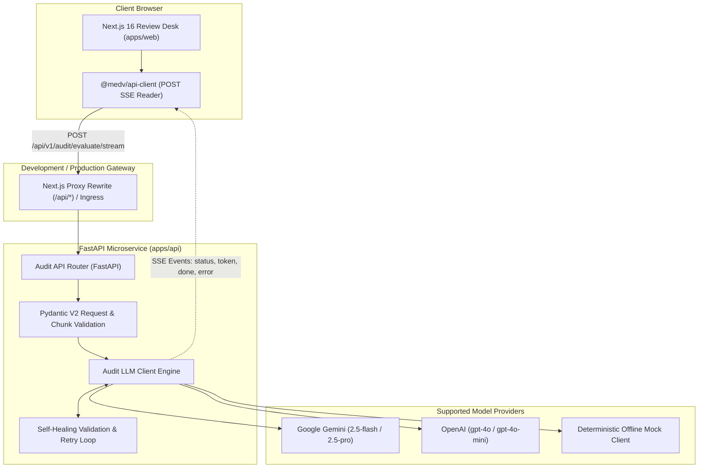

# MedVigil

<div align="center">

**AI-Powered Clinical Documentation Audit & Prior-Authorization Review Engine**

[](https://fastapi.tiangolo.com)
[](https://nextjs.org)
[](https://react.dev)
[](https://www.typescriptlang.org)
[](https://tailwindcss.com)
[](https://turbo.build)
[](https://pnpm.io)
[](https://www.python.org)
[](https://github.com)

</div>

---

## Table of Contents

- [Overview](#overview)
- [System Architecture](#system-architecture)
- [Key Features](#key-features)
- [Repository Structure](#repository-structure)
- [Quick Start](#quick-start)
  - [Prerequisites](#prerequisites)
  - [Installation](#installation)
  - [Environment Configuration](#environment-configuration)
- [Development Workflow](#development-workflow)
- [API & Streaming Protocol](#api--streaming-protocol)
- [Contract-First Generation](#contract-first-generation)
- [Semantic Evaluation & Benchmarking](#semantic-evaluation--benchmarking)
- [Testing & Quality Assurance](#testing--quality-assurance)
- [Clinical Safety & Enterprise Design](#clinical-safety--enterprise-design)
- [Documentation Index](#documentation-index)
- [License](#license)

---

## Overview

In healthcare utilization management and prior authorization (PA), documentation omissions and ambiguities lead to high claim denial rates, physician administrative burden, and delayed patient care.

**MedVigil** is an enterprise-grade clinical documentation review platform. It audits unstructured physician encounter notes against payer policy rubrics (such as medical-necessity criteria for advanced lumbar MRI), identifying clinical gaps and producing structured, citation-backed evaluation reports.

### The Problem It Solves

- **Subjective / Manual Audits**: Manual review of complex insurance criteria is slow and prone to inconsistency.
- **Hallucinated Approvals**: Standard generative AI often infers clinical evidence that does not exist in the record. MedVigil enforces strict **"Evidence Before Inference"** constraints.
- **Latency & Workflow Friction**: Physicians and audit reviewers need immediate feedback. MedVigil delivers real-time token streaming via Server-Sent Events (SSE) while tracking Time-to-First-Token (TTFT) and throughput.

---

## System Architecture

MedVigil operates as a symmetric monorepo. FastAPI owns the domain logic, Pydantic contracts, LLM integrations, and security enforcement. Next.js provides the clinician review workspace and consumes streaming SSE events through an end-to-end typed client.



---

## Key Features

- **Real-Time Token Streaming (POST SSE)**: Real-time token streaming over HTTP POST using `eventsource-parser` and `fetch`. Does not require awkward GET query param encoding for large clinical notes.
- **Terminal Report Validation**: Partial or streaming JSON is never treated as a completed audit. Only schemas that pass full Pydantic and Zod runtime validation upon receiving the terminal `done` event are rendered to the clinical team.
- **Multi-Provider Engine**:
  - **Google Gemini**: Built on the modern `google-genai` SDK (`gemini-2.5-flash`, `gemini-2.5-pro`).
  - **OpenAI**: Structured output parsing with streaming delta handling and refusal detection (`gpt-4o`, `gpt-4o-mini`).
  - **Offline Mock**: Zero-cost, deterministic, chunked simulation for offline testing, CI pipelines, and local development.
- **Self-Healing LLM Feedback Loop**: If an LLM response fails schema validation, Pydantic validation errors are automatically formatted into feedback prompts and resubmitted to the model for self-correction.
- **Contract-First Type Safety**: Single source of truth in FastAPI Pydantic models. OpenAPI exports compile automatically into TypeScript interfaces and runtime Zod schemas.
- **Client Disconnect Handling**: Detects connection aborts mid-stream (`request.is_disconnected()`) and shuts down background generation pipelines immediately to conserve model quota.
- **Interactive Review Desk**: Next.js App Router workspace with side-by-side note & rubric inspection, live TTFT / chunk latency metrics, a physician clarification queue, and criterion-by-criterion status badges (`met`, `unclear`, `missing`).

---

## Repository Structure

```text
MedV_micro_service/
├── apps/
│   ├── api/                           # FastAPI backend service
│   │   ├── app/
│   │   │   ├── api/v1/                # Health & audit endpoints (sync + SSE)
│   │   │   ├── core/                  # App configuration & retry logic
│   │   │   ├── schemas/               # Canonical Pydantic schemas (AuditRequest, ClinicalGapReport)
│   │   │   ├── services/              # LLM providers (Gemini, OpenAI, Mock)
│   │   │   └── static/                # Standalone HTML demo interface
│   │   ├── tests/                     # 34 automated pytest suites
│   │   ├── scripts/                   # OpenAPI contract export script
│   │   └── pytest.ini
│   └── web/                           # Next.js 16 clinical review application
│       ├── src/
│       │   ├── app/                   # App Router pages (/audit, /demo redirect)
│       │   └── features/audit/        # State reducer, streaming hooks, fixtures & UI components
│       └── e2e/                       # Playwright end-to-end integration tests
├── packages/
│   ├── api-client/                    # Generated OpenAPI contracts, Zod schemas & SSE client
│   └── typescript-config/             # Shared TypeScript configuration
├── scripts/
│   ├── run_eval.py                    # Semantic benchmark against ground-truth clinical cases
│   ├── benchmark_latency.py           # TTFT and latency benchmark across temperatures
│   └── test_stream.py                 # CLI streaming validation utility
├── clinical_notes/                    # Synthetic clinical encounter records
├── policy_rubrics/                    # Payer prior-authorization policy guidelines
├── eval_cases/                        # Ground-truth evaluation benchmarks & historical metrics
├── docs/                              # Architecture, getting started & migration documentation
├── package.json                       # Turborepo scripts & dependencies
├── pnpm-workspace.yaml                # Monorepo workspace configuration
└── turbo.json                         # Build pipeline cache definitions
```

---

## Quick Start

### Prerequisites

- **Python 3.13+**
- **Node.js 20+**
- **pnpm 11+** (`corepack enable`)

### Installation

1. **Clone the repository:**
   ```powershell
   git clone https://github.com/your-org/MedV_micro_service.git
   cd MedV_micro_service
   ```

2. **Configure Python Virtual Environment:**
   ```powershell
   python -m venv .venv
   .\.venv\Scripts\Activate.ps1
   python -m pip install --upgrade pip
   python -m pip install -r apps/api/requirements.txt
   ```

3. **Install Monorepo Node Dependencies:**
   ```powershell
   corepack enable
   pnpm install
   ```

### Environment Configuration

Copy the backend environment template:
```powershell
Copy-Item apps/api/.env.example apps/api/.env
```

Edit `apps/api/.env`:

| Variable | Description | Default / Options |
|---|---|---|
| `LLM_PROVIDER` | Active LLM client | `mock` *(zero cost)*, `gemini`, `openai` |
| `GEMINI_API_KEY` | Google AI Studio API key | Required if provider is `gemini` |
| `GEMINI_MODEL` | Gemini model identifier | `gemini-2.5-flash` |
| `OPENAI_API_KEY` | OpenAI API key | Required if provider is `openai` |
| `OPENAI_MODEL` | OpenAI model identifier | `gpt-4o` |
| `CORS_ORIGINS` | Permitted browser origins | `http://localhost:3000,http://127.0.0.1:3000` |
| `APP_NAME` | Service name | `MedV Microservice` |

> [!TIP]
> Setting `LLM_PROVIDER=mock` allows full local UI and API testing with simulated token streaming without requiring external API keys.

---

## Development Workflow

Start all services concurrently with Turborepo:

```powershell
# Activate your Python virtual environment first
.\.venv\Scripts\Activate.ps1

# Launch both API (port 8000) and Web (port 3000)
pnpm dev
```

Or run services independently:

```powershell
pnpm dev:api   # Starts Uvicorn on http://127.0.0.1:8000 with reload
pnpm dev:web   # Starts Next.js on http://127.0.0.1:3000
```

### Key Service Interfaces

| Service | Address | Description |
|---|---|---|
| **Clinical Audit Desk** | [http://127.0.0.1:3000/audit](http://127.0.0.1:3000/audit) | Next.js review application with real-time SSE streaming |
| **Interactive API Docs** | [http://127.0.0.1:8000/docs](http://127.0.0.1:8000/docs) | Swagger UI for exploring and testing endpoints |
| **Alternative Docs** | [http://127.0.0.1:8000/redoc](http://127.0.0.1:8000/redoc) | ReDoc technical API documentation |
| **Health Check** | [http://127.0.0.1:8000/api/v1/health](http://127.0.0.1:8000/api/v1/health) | Liveness and service metadata probe |
| **Legacy HTML Demo** | [http://127.0.0.1:8000/demo](http://127.0.0.1:8000/demo) | Standalone client for direct backend testing |

---

## API & Streaming Protocol

### Streaming Endpoint

`POST /api/v1/audit/evaluate/stream`

#### Request Payload

```json
{
  "clinical_note": "Patient presents with persistent lower-back pain for eight weeks. Neurological exam completed.",
  "policy_rubric": "RUBRIC ID: MRI_PA_001\n1. Symptoms and Duration: Document primary back symptoms and specific duration.",
  "rubric_id": "MRI_PA_001",
  "temperature": 0.0
}
```

#### Server-Sent Events Protocol

The endpoint delivers structured SSE frames with JSON payloads adhering to `StreamChunk`:

```http
HTTP/1.1 200 OK
Content-Type: text/event-stream
Cache-Control: no-cache, no-transform
X-Accel-Buffering: no

event: status
data: {"event":"status","message":"Evaluating clinical note against rubric...","retries":0}

event: token
data: {"event":"token","text":"{\"rubric_id\": \"MRI_PA_001\""}

event: done
data: {"event":"done","report":{"rubric_id":"MRI_PA_001","evaluations":[{"criterion":"Symptoms and Duration","status":"met","evidence":"lower-back pain for eight weeks","explanation":"Specific duration documented.","suggested_clarification":null}],"missing_or_unclear_summary":[]},"retries":0}
```

#### Event Lifecycle

| Event Type | Purpose | Key Fields |
|---|---|---|
| `status` | Reports progress, connection updates, or retry attempts | `message`, `retries` |
| `token` | Incremental raw JSON text chunks streamed from the LLM | `text` |
| `done` | Emits the complete, validated `ClinicalGapReport` | `report` |
| `error` | Emits sanitized failure details with a support identifier | `error`, `request_id` |

#### Testing with `curl`:

```powershell
curl.exe -N -X POST "http://127.0.0.1:8000/api/v1/audit/evaluate/stream" `
  -H "Content-Type: application/json" `
  -d '{"clinical_note": "Patient reports back pain for 8 weeks.", "policy_rubric": "RUBRIC ID: MRI_01\n1. Symptoms and Duration"}'
```

---

## Contract-First Generation

The frontend client is strictly derived from FastAPI's OpenAPI specification. When adding or modifying backend models or endpoints:

```powershell
# 1. Export OpenAPI JSON and generate TypeScript definitions
pnpm contracts:generate

# 2. In CI: Ensure committed contracts match current backend schemas
pnpm contracts:check
```

Pipeline details:
1. `apps/api/scripts/export_openapi.py` exports `openapi.json`.
2. `openapi-typescript` translates the specification into [`packages/api-client/src/generated/schema.d.ts`](file:///e:/Projects/MedV_micro_service/packages/api-client/src/generated/schema.d.ts).
3. Runtime Zod schemas in [`packages/api-client/src/schemas.ts`](file:///e:/Projects/MedV_micro_service/packages/api-client/src/schemas.ts) validate all incoming wire payloads.

---

## Semantic Evaluation & Benchmarking

The repository includes tools for measuring clinical evaluation accuracy and streaming performance.

### 1. Ground-Truth Semantic Evaluation (`scripts/run_eval.py`)

Compares model decisions against ground-truth physician evaluations across synthetic clinical cases:

```powershell
# Run using the offline mock provider (zero cost)
python scripts/run_eval.py --provider mock

# Evaluate with Gemini 2.5 Flash
python scripts/run_eval.py --provider gemini --model gemini-2.5-flash

# Evaluate a specific test case
python scripts/run_eval.py --case-id eval_001
```

Exports precision, recall, and per-criterion mismatch summaries to `eval_cases/eval_results.json`.

### 2. Latency & TTFT Benchmarking (`scripts/benchmark_latency.py`)

Measures Time-to-First-Token, overall streaming duration, token count, and tokens-per-second across temperature sweeps:

```powershell
python scripts/benchmark_latency.py --provider mock --runs 3 --temperatures 0.0,0.7
```

---

## Testing & Quality Assurance

MedVigil maintains multi-layered test coverage across both backend and frontend.

```powershell
# Run all workspace tests
pnpm test

# Run TypeScript checks across packages
pnpm typecheck

# Run linter
pnpm lint

# Production build
pnpm build
```

### Targeted Test Suites

- **Backend Pytest** (34 tests including unit, integration, streaming, and retry tests):
  ```powershell
  python -m pytest -c apps/api/pytest.ini -v
  ```
- **Web Unit / Component Tests** (Vitest):
  ```powershell
  pnpm test:web
  ```
- **End-to-End User Journeys** (Playwright):
  ```powershell
  pnpm test:e2e
  ```

---

## Clinical Safety & Enterprise Design

1. **Evidence Before Inference**:
   - For any criterion marked `met`, the system must extract verbatim supporting sentences as `evidence`.
   - Criteria marked `missing` sanitize evidence to `null`, preventing hallucinated justifications.
   - Criteria marked `unclear` must provide an explicit, non-punitive `suggested_clarification` request to the physician.
2. **Credential Isolation**:
   - Provider API keys reside solely in server-side environment variables and are never transmitted to client bundles.
3. **Resilience & Fault Tolerance**:
   - Transient 429 and 503 errors use exponential backoff with randomized jitter.
   - Malformed model responses trigger an automated validation retry loop that feeds Pydantic error details back to the LLM for self-correction.
4. **Security & PHI Protection**:
   - Mid-stream exceptions are masked behind generic error messages with unique request correlation IDs (`request_id`) for internal log auditing.

---

## Documentation Index

- [Getting Started Guide](docs/getting_started.md): Local environment setup, dependencies, and configuration.
- [Running and Testing](docs/running_and_testing.md): CLI operations, manual endpoint testing, and CI commands.
- [Project Architecture & Structure](docs/project_structure.md): Monorepo responsibilities, request lifecycles, and extension rules.
- [Monorepo Implementation Plan](docs/nextjs_monorepo_implementation_plan.md): Architectural decisions and migration blueprint.

---

## License

This project is licensed under the terms of the [MIT License](LICENSE).

---

<div align="center">
Built with strict typed contracts, real-time streaming, and clinical safety constraints.
</div>
